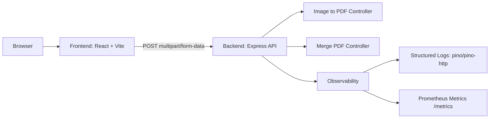

# PDF Tools SaaS

Web app for PDF and image utilities with a React frontend and Express backend.

- Frontend: Vite + React + TypeScript
- Backend: Express 5 + TypeScript
- File workflows: image-to-pdf, merge-pdf, plus client-side tools

## Monorepo Layout

```text
pdf-tools-saas/
|- frontend/
|  |- src/
|  |- package.json
|- backend/
|  |- src/
|  |- package.json
|- README.md
```

## Local Development

### Prerequisites

- Node.js 20+ (Node 22+ recommended)
- npm 10+
- Windows/macOS/Linux

### 1. Install dependencies

```bash
cd frontend && npm install
cd ../backend && npm install
```

### 2. Configure environment files

Create local env files from examples.

```bash
# from repo root
cp frontend/.env.example frontend/.env
cp backend/.env.example backend/.env
```

Windows PowerShell equivalent:

```powershell
Copy-Item frontend/.env.example frontend/.env
Copy-Item backend/.env.example backend/.env
```

### 3. Run backend

```bash
cd backend
npm run dev
```

Backend default URL: `http://localhost:5000`

Health check: `GET http://localhost:5000/health`

### 4. Run frontend

Open another terminal:

```bash
cd frontend
npm run dev
```

Frontend default URL: `http://localhost:5173`

## Environment Variables

### Frontend (`frontend/.env`)

```env
VITE_API_URL=http://localhost:5000
```

### Backend (`backend/.env`)

```env
PORT=5000
CORS_ORIGINS=http://localhost:5173
BODY_LIMIT=1mb
TRUST_PROXY=false
LOG_LEVEL=info
ENABLE_METRICS=false
NODE_ENV=development
```

Notes:

- `CORS_ORIGINS` accepts comma-separated origins.
- Set `ENABLE_METRICS=true` to expose `/metrics`.

## Scripts

### Frontend

- `npm run dev` - start Vite dev server
- `npm run build` - type-check + production build
- `npm run preview` - preview production build
- `npm run lint` - run eslint

### Backend

- `npm run dev` - run TS server with hot reload
- `npm run build` - compile TypeScript to `dist/`
- `npm start` - run compiled server

## API Endpoints

- `GET /health`
- `POST /api/convert/image-to-pdf`
- `POST /api/convert/merge-pdf`
- `GET /metrics` (only when `ENABLE_METRICS=true`)

## Architecture



Request flow summary:

1. Frontend calls backend via `frontend/src/lib/api.ts`.
2. Backend assigns/propagates `x-request-id`.
3. Request/response is logged by `pino-http`.
4. Errors return normalized payloads including `errorId`.
5. Metrics are recorded and exposed at `/metrics` when enabled.

## Observability

Backend observability additions:

- Structured request logs with `pino` + `pino-http`
- Request correlation via `x-request-id`
- Error responses include `errorId`
- Optional Prometheus metrics endpoint (`/metrics`)

Example error payload:

```json
{
  "success": false,
  "errorId": "0f8fad5b-d9cb-469f-a165-70867728950e",
  "code": "INTERNAL_SERVER_ERROR",
  "message": "Unexpected server error"
}
```

## Deployment Notes

### Frontend deployment

- Build with `npm run build` in `frontend/`
- Deploy `frontend/dist` to static hosting (Vercel, Netlify, S3+CDN, etc.)
- Set `VITE_API_URL` to your backend public URL

### Backend deployment

- Build with `npm run build` in `backend/`
- Start with `npm start` (serves `dist/server.js`)
- Set production env vars:
  - `NODE_ENV=production`
  - `PORT` from platform
  - `CORS_ORIGINS` with frontend domain(s)
  - `TRUST_PROXY=1` when behind reverse proxy
  - `ENABLE_METRICS=true` if scraping with Prometheus

### Reverse proxy and ingress

- Forward `x-request-id` if your gateway generates one
- Ensure request body/upload limits match backend limits
- Restrict `/metrics` exposure to internal network or auth-protected path

## Troubleshooting

- CORS errors:
  - confirm `CORS_ORIGINS` includes frontend URL exactly
- 413 payload too large:
  - check `BODY_LIMIT` and upload size constraints
- Frontend cannot reach backend:
  - verify `VITE_API_URL` and backend port
- No metrics endpoint:
  - set `ENABLE_METRICS=true` and restart backend
